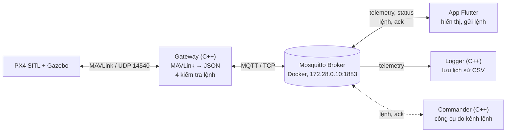
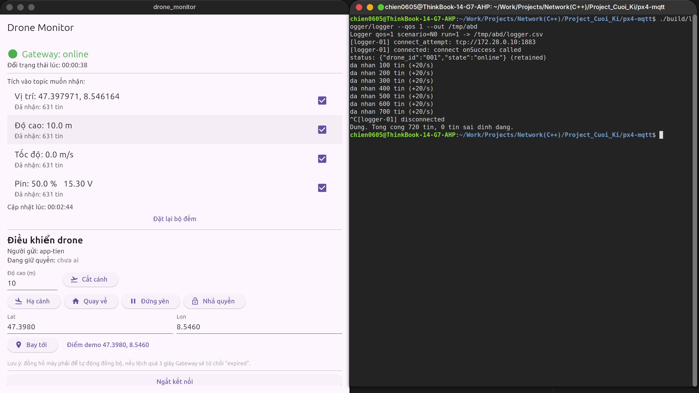

# PX4 MQTT – Thu thập và phân phối dữ liệu drone qua MQTT

Đồ án môn Lập trình mạng. Một drone mô phỏng (PX4 SITL + Gazebo) gửi telemetry qua MAVLink/UDP, nhưng nhiều ứng
dụng cùng cần dữ liệu đó: màn hình giám sát, hệ thống lưu trữ, người điều khiển. Nhóm đặt một **Gateway C++** đọc
MAVLink, chuẩn hoá thành JSON và publish lên **Broker MQTT** (Mosquitto). Mỗi ứng dụng chỉ cần subscribe đúng topic
mình cần; thêm một bên nhận không phải sửa gì ở phía drone.

Trọng tâm của đề tài là **đo bằng thực nghiệm** hành vi của MQTT trên TCP: QoS 0 và QoS 1 khi mạng xấu, khả năng
phục hồi khi Broker, Gateway hay bên nhận bị gián đoạn, và một **kênh lệnh điều khiển ngược** có bốn kiểm tra an toàn.



Telemetry và trạng thái đi từ drone lên các bên nhận; lệnh đi theo chiều ngược lại, từ App (hoặc Commander) qua Broker
tới Gateway rồi tới drone. Commander là công cụ dòng lệnh dùng để đo kênh lệnh.

## Kết quả chính

Điều kiện đo: một máy Linux; Broker trong Docker; Gateway phát 4 topic × 5 tin/s = 20 tin/s; Logger chạy cùng máy
với Gateway (chung đồng hồ) để đo độ trễ; netem đặt trên card mạng của Broker; mỗi trường hợp chạy 3 lần.

| Thí nghiệm | Tình huống | Kết quả |
|---|---|---|
| A | Hai client cùng nhận, tắt một client | Client còn lại vẫn nhận đủ, đều 20 tin/s |
| B | App chỉ subscribe `battery` | Chỉ tin `battery` tăng (≈ 5 tin/s); việc lọc làm ở Broker |
| C | Tắt Broker 15 s (QoS 1) | Bộ đệm Gateway tắt: **mất 400 tin (11,1 %)**. Bộ đệm bật: **mất 0 tin**, tin xả bù trễ tối đa ≈ 19,5 s |
| D | Gateway tắt bằng Ctrl+C hoặc `kill -9` | App hiện `offline` **dưới 1 s** (Gateway tự báo, hoặc Broker phát Last Will) |
| E | Mạng xấu N1–N3, QoS 0 và QoS 1 | Nhận **100 %**, 0 tin trùng ở mọi điều kiện; mạng xấu chỉ làm tăng độ trễ |
| F | Logger tắt 15 s rồi chạy lại | QoS 1 + phiên bền: **nhận bù 100 %**. QoS 0: mất 300–304 tin (8,3–8,4 %) |
| H | Kênh lệnh điều khiển | 7200 lệnh qua 4 điều kiện mạng, **không mất lệnh nào**; lệnh bị giữ 11 s bị chặn (`expired`) |

Độ trễ ở thí nghiệm E (ms, trung bình 3 lần chạy):

| Điều kiện | netem | QoS 0: trung vị / p95 | QoS 1: trung vị / p95 |
|---|---|---|---|
| N0 | không | 1 / 2 | 1 / 2 |
| N1 | trễ 100 ms | 147 / 301 | 175 / 342 |
| N2 | mất 5 % gói | 1 / 234 | 1 / 213 |
| N3 | trễ 100 ms + mất 5 % | 211 / 573 | 241 / 589 |


- **Khi kết nối TCP còn sống, không mất tin nào, kể cả QoS 0.** TCP gửi lại đoạn bị mất, nên mạng xấu chỉ biến
  thành độ trễ (p95 tới khoảng 0,6 s ở N3). QoS 1 không cải thiện gì trong trường hợp này.
- **Khi mất hẳn kết nối, mỗi loại sự cố cần đúng cơ chế của nó:** Broker hỏng cần bộ đệm ở Gateway; bên nhận tạm
  vắng cần QoS 1 cùng phiên bền; Gateway chết cần Last Will cùng tin trạng thái retained.
- **Trễ ở N1 lớn hơn 100 ms là do thuật toán Nagle** trên Broker. Bật `set_tcp_nodelay true` thì trung vị về
  102–103 ms.
- **Với lệnh điều khiển, tới muộn còn nguy hiểm hơn mất lệnh.** Phiên bền giữ hộ lệnh khi Gateway vắng mặt, nên cần
  thêm hạn dùng lệnh (3 s).

## Thiết kế MQTT

| Topic | Chiều | QoS | Retained | Nội dung |
|---|---|---|---|---|
| `drone/001/position` | Gateway → bên nhận | 0 hoặc 1 | không | `lat`, `lon` (độ) |
| `drone/001/altitude` | Gateway → bên nhận | 0 hoặc 1 | không | `rel_m` (m so với điểm cất cánh) |
| `drone/001/velocity` | Gateway → bên nhận | 0 hoặc 1 | không | `ground_mps` (tốc độ ngang) |
| `drone/001/battery` | Gateway → bên nhận | 0 hoặc 1 | không | `percent`, `voltage` |
| `drone/001/status` | Gateway, hoặc Broker khi phát Last Will | 1 | **có** | `online` / `offline` |
| `drone/001/cmd` | người điều khiển → Gateway | 1 | **không bao giờ** | lệnh điều khiển |
| `drone/001/cmd/ack` | Gateway → người điều khiển | 1 | không | kết quả lệnh và lý do |

Mỗi tin telemetry là một JSON. Bộ ba `(boot_id, topic, seq)` định danh duy nhất từng tin, để đối chiếu tin đã gửi
với tin đã nhận và phát hiện tin mất, tin trùng:

```json
{ "drone_id": "001", "boot_id": 1794725887306, "seq": 125,
  "timestamp_ms": 1794725900000, "field": "battery",
  "value": { "percent": 87.0, "voltage": 15.8 } }
```

| Cơ chế | Tham số | Chống sự cố nào |
|---|---|---|
| Keep-alive | 10 s (App: 20 s); Broker coi client đã chết sau 1,5 × keep-alive | Kết nối chết mà không ai đóng TCP |
| Tự kết nối lại | chờ 1 → 2 → 4 → 8 s | Broker khởi động lại, mạng đứt tạm thời |
| Bộ đệm phía Gateway | tối đa 1000 tin, trong RAM | Mất kết nối tới Broker |
| Phiên bền (`clean_session = 0`) | Broker giữ tối đa 5000 tin QoS 1 mỗi client | Bên nhận tạm vắng |
| Last Will + `status` retained | `offline`, QoS 1, retained | Gateway chết đột ngột |

Kênh lệnh: Gateway cho mỗi lệnh qua bốn kiểm tra theo thứ tự (từ chối lệnh **retained**, lệnh **quá hạn** 3 s, lệnh
**trùng** `(from, cmd_id)`, và lệnh của người **không giữ quyền** điều khiển), rồi mới chuyển cho drone. Mọi lệnh,
kể cả bị từ chối, đều có ack kèm lý do. Chi tiết: [`docs/command_channel.md`](docs/command_channel.md).

## Hình ảnh

| App nhận dữ liệu, Logger đếm tin (thí nghiệm A) | App chỉ nhận `battery` (thí nghiệm B) |
|---|---|
|  |  |
| **App điều khiển: cất cánh 15 m (thí nghiệm H)** | **Wireshark: Broker phát Last Will sau `kill -9`** |
|  |  |

## Yêu cầu và cài đặt

- Ubuntu 22.04 hoặc 24.04 (hoặc WSL2), CMake ≥ 3.16, trình biên dịch C++17
- Paho MQTT C/C++, nlohmann-json, Docker (Broker dùng image `eclipse-mosquitto:2.1.2-alpine`)
- MAVSDK C++ (đã build với bản 3.17.5) cho Gateway
- PX4-Autopilot v1.17.0 (SITL) + Gazebo Harmonic, QGroundControl
- Flutter cho App (xem [`app/README.md`](app/README.md))

```bash
sudo apt install build-essential cmake git iproute2 nlohmann-json3-dev libpaho-mqtt-dev libpaho-mqttpp-dev \
    libssl-dev mosquitto-clients docker.io
sudo usermod -aG docker $USER   # đăng xuất rồi vào lại để dùng docker không cần sudo
```

Nếu `apt` không có `libpaho-mqttpp-dev`, build Paho từ mã nguồn theo hướng dẫn ở
github.com/eclipse-paho/paho.mqtt.cpp. MAVSDK cài bằng gói `.deb` trên trang Releases của
github.com/mavlink/MAVSDK (`sudo dpkg -i`).

## Chạy nhanh

```bash
cmake -B build && cmake --build build -j
ctest --test-dir build                 # test 4 kiểm tra lệnh, không cần Broker hay PX4

./scripts/setup_broker.sh              # dựng Broker 172.28.0.10:1883, tài khoản drone/drone123
# terminal khác: chạy drone mô phỏng (Gateway chờ PX4 tối đa 10 s)
#   cd ~/PX4-Autopilot && make px4_sitl gz_x500
./build/logger/logger --qos 1 --out data/thu
./build/gateway/gateway --qos 1 --out data/thu
./scripts/netem.sh N1                  # đặt điều kiện mạng: N0 | N1 | N2 | N3 | show (cần sudo)
./build/commander/commander --action takeoff --alt 15
```

App: `cd app && flutter run -d linux`, rồi bấm **Kết nối**. Ô IP Broker để `127.0.0.1` khi chạy cùng máy với
Broker; điện thoại trong cùng mạng LAN thì nhập IP của laptop.

## Tái lập thí nghiệm

Mọi script chạy từ thư mục gốc repo, cần Broker và PX4 SITL đang chạy. Định dạng các file CSV:
[`data/README.md`](data/README.md).

| Thí nghiệm | Cách chạy | Kết quả | Báo cáo |
|---|---|---|---|
| A, B, D | Làm tay theo báo cáo, chụp màn hình | `data/A`, `data/B`, `data/D` | [`bao_cao_thi_nghiem_ABD.md`](docs/bao_cao_thi_nghiem_ABD.md) |
| C, F | `./scripts/run_CF.sh c` · `./scripts/run_CF.sh f`, tổng hợp bằng `./scripts/summarize_CF.sh` | `data/C`, `data/F`, `data/summary_CF.md` | [`bao_cao_thi_nghiem_CF.md`](docs/bao_cao_thi_nghiem_CF.md) |
| E | `./scripts/run_all_E.sh` (24 lượt, tự gọi `b_analyze`) | `data/E`, `data/plots` | [`bao_cao_thi_nghiem_E.md`](docs/bao_cao_thi_nghiem_E.md) |
| H | `./scripts/run_H.sh all`, tổng hợp bằng `./scripts/summarize_H.sh` | `data/H` | [`bao_cao_kenh_lenh.md`](docs/bao_cao_kenh_lenh.md) |
| Wireshark | `./scripts/capture_pcap.sh` (cần sudo) | `data/pcap` | [`data/pcap/README.md`](data/pcap/README.md) |

## Cấu trúc thư mục

```
common/      hằng số chung (config.hpp), định dạng JSON, tham số dòng lệnh, MqttLink (phần MQTT dùng chung)
gateway/     PX4 (MAVSDK) → JSON → MQTT; kênh lệnh và 4 kiểm tra an toàn; test
logger/      subscribe drone/001/#, ghi telemetry ra CSV
commander/   gửi lệnh từ dòng lệnh, đo thời gian khứ hồi (thí nghiệm H)
app/         App Flutter: hiển thị, chọn topic, điều khiển
mosquitto/   cấu hình Broker
scripts/     dựng Broker, netem, chạy thí nghiệm, phân tích, bắt gói
data/        số liệu, ảnh chụp, file pcap, biểu đồ
docs/        kế hoạch, báo cáo từng thí nghiệm, giao thức kênh lệnh
```

## Tài liệu

| Tài liệu | Nội dung |
|---|---|
| [`docs/Ke_hoach_lam_viec_PX4_MQTT.docx`](docs/Ke_hoach_lam_viec_PX4_MQTT.docx) | Kế hoạch: quy ước topic, JSON, thiết kế thí nghiệm |
| [`docs/command_channel.md`](docs/command_channel.md) | Giao thức lệnh và ack, bốn kiểm tra an toàn |
| [`docs/bao_cao_thi_nghiem_ABD.md`](docs/bao_cao_thi_nghiem_ABD.md) | Thí nghiệm A, B, D: nhiều client, lọc topic, Last Will |
| [`docs/bao_cao_thi_nghiem_CF.md`](docs/bao_cao_thi_nghiem_CF.md) | Thí nghiệm C, F: Broker gián đoạn, bên nhận vắng mặt |
| [`docs/bao_cao_thi_nghiem_E.md`](docs/bao_cao_thi_nghiem_E.md) | Thí nghiệm E: QoS 0 và QoS 1 khi mạng xấu, Nagle |
| [`docs/bao_cao_kenh_lenh.md`](docs/bao_cao_kenh_lenh.md) | Thí nghiệm H: kênh lệnh điều khiển |
| [`docs/PART_B_GUIDE.md`](docs/PART_B_GUIDE.md) | Trình chạy thí nghiệm, công cụ phân tích, Wireshark |
| [`data/README.md`](data/README.md) | Cách tổ chức số liệu và cột của từng file CSV |
| [`data/pcap/README.md`](data/pcap/README.md) | Các file bắt gói và cách đọc từng ảnh chụp |

## Hạn chế

- netem đặt trên card mạng của Broker nên chỉ làm xấu chiều Broker → client; chiều Gateway → Broker không bị ảnh hưởng.
- Chưa mã hoá (không TLS); tài khoản MQTT dùng chung, chỉ phù hợp mạng thử nghiệm.
- Bộ đệm của Gateway nằm trong RAM: Gateway tắt khi còn tin trong bộ đệm thì mất hết.
- Thời gian phát hiện kết nối chết lặng (15 s) suy ra từ cấu hình keep-alive theo chuẩn MQTT 3.1.1, chưa đo.
- Tắt Nagle thì trung vị ở N1 về đúng 100 ms, nhưng p95 vẫn khoảng 200 ms; phần này chưa tìm ra nguyên nhân.
- Khứ hồi lệnh QoS 1 khoảng 42 ms được giải thích bằng Nagle gặp delayed ACK; đây là giả thuyết, chưa xác nhận bằng
  Wireshark.

## Nhóm và quy tắc làm việc

| Phần | Phụ trách |
|---|---|
| `common/`, `logger/`, phần MQTT của `gateway/`, `mosquitto/`, Broker và netem | Chiến |
| Phần PX4 (MAVSDK) của `gateway/` | Người có máy chạy PX4 |
| `app/`, kênh lệnh trên App | Tiên |
| Trình chạy thí nghiệm, phân tích, `data/` | Nhật |

Quy tắc Git:

1. Không push thẳng lên `main`. Mỗi việc một nhánh, ví dụ `feature/logger`; làm xong mở pull request, một bạn
   review rồi mới merge.
2. Đầu buổi: `git checkout main && git pull`, rồi `git checkout -b feature/<tên-việc>`.
3. Muốn đổi quy ước chung (topic, JSON, IP, tài khoản) thì sửa `common/include/common/config.hpp` qua pull request
   và báo cả nhóm.
4. Không đẩy thư mục build, `mosquitto/data/` và `mosquitto/config/passwd` (đã có trong `.gitignore`).
