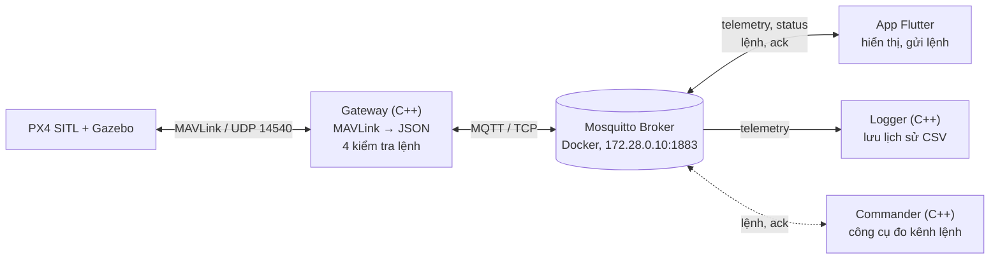
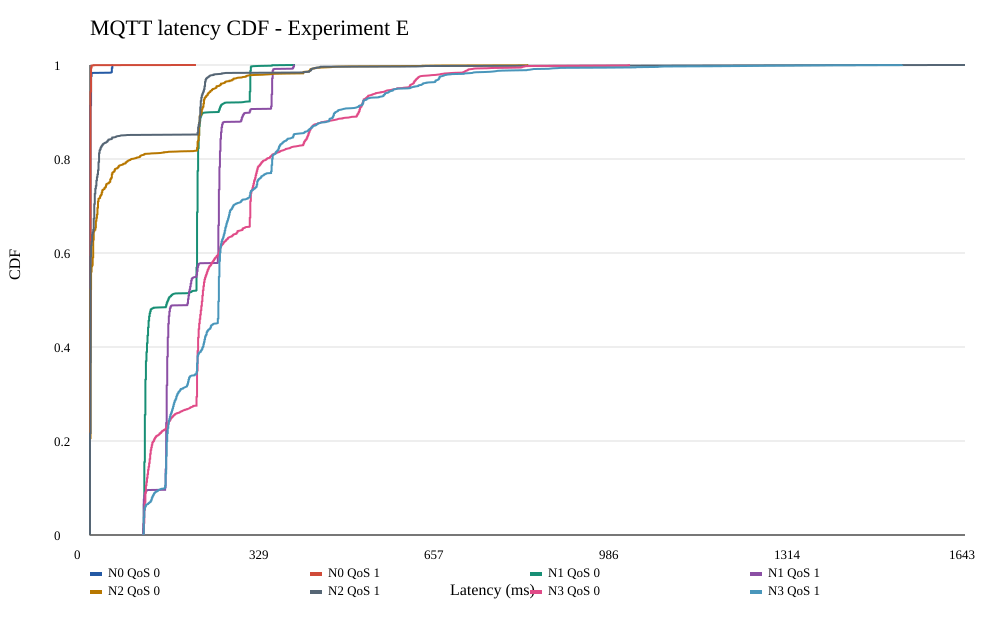
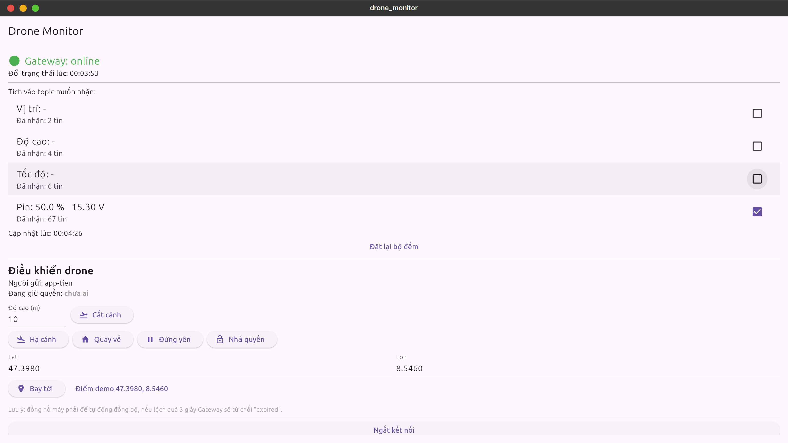
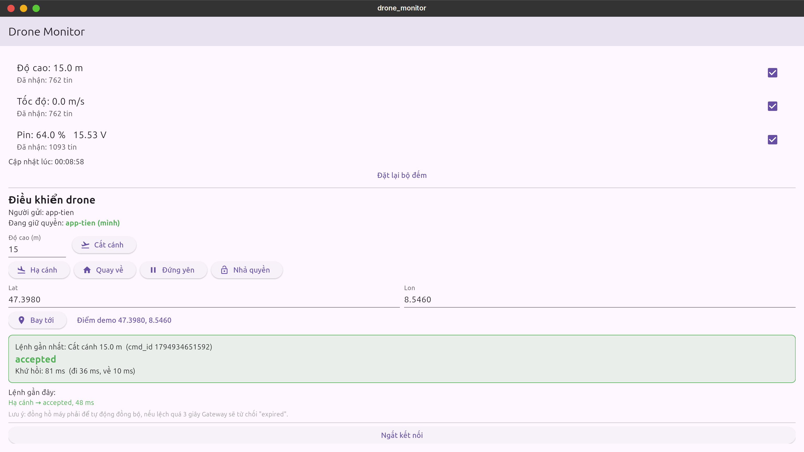
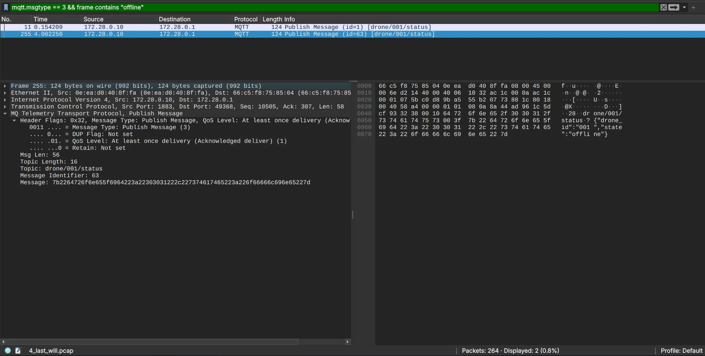

# PX4 MQTT – Thu thập và phân phối dữ liệu drone qua MQTT

Đồ án môn Lập trình mạng. Một drone mô phỏng (PX4 SITL + Gazebo) gửi telemetry qua MAVLink/UDP, nhưng nhiều ứng
dụng cùng cần dữ liệu đó: màn hình giám sát, hệ thống lưu trữ, người điều khiển. Nhóm đặt một **Gateway C++** đọc
MAVLink, chuẩn hoá thành JSON và publish lên **Broker MQTT** (Mosquitto). Mỗi ứng dụng chỉ cần subscribe đúng topic
mình cần; thêm một bên nhận không phải sửa gì ở phía drone.

Trọng tâm của đề tài là **đo bằng thực nghiệm** hành vi của MQTT trên TCP: QoS 0 và QoS 1 khi mạng xấu, khả năng
phục hồi khi Broker, Gateway hay bên nhận bị gián đoạn, và một **kênh lệnh điều khiển ngược** có bốn kiểm tra an toàn.



Telemetry và trạng thái đi từ drone lên các bên nhận; lệnh đi theo chiều ngược lại, từ App (hoặc Commander) qua Broker
tới Gateway rồi tới drone. Commander là công cụ dòng lệnh dùng để đo kênh lệnh.

## Câu hỏi nghiên cứu

1. Khi mạng xấu (trễ, mất gói) nhưng kết nối TCP vẫn sống, QoS 1 có giúp nhận đủ tin hơn QoS 0 không, và phải trả
   giá bao nhiêu về độ trễ?
2. Khi mất hẳn kết nối (Broker hỏng, bên nhận tạm vắng, Gateway chết), cơ chế nào của MQTT giữ được dữ liệu và
   trạng thái?
3. Các tính năng giữ tin và giao lại của MQTT có an toàn cho **lệnh điều khiển** gửi ngược về drone không?
4. Vì sao độ trễ đo được lớn hơn độ trễ mạng đặt bằng netem?

## Giả thuyết

| # | Giả thuyết | Kết quả |
|---|---|---|
| GT1 | Trên kết nối TCP còn sống, TCP tự truyền lại gói mất nên QoS 0 cũng nhận đủ; QoS 1 không cải thiện tỷ lệ nhận, mạng xấu chỉ làm tăng trễ | **Đúng** (E) |
| GT2 | Khi mất kết nối, chỉ cơ chế giữ tin **đúng chỗ** mới chống mất: bộ đệm ở Gateway khi Broker hỏng; QoS 1 + phiên bền khi bên nhận vắng; Last Will khi Gateway chết | **Đúng** (C, F, D) |
| GT3 | Phiên bền và bộ đệm làm lệnh tới muộn, QoS 1 làm lệnh tới lại; Gateway phải tự kiểm tra từng lệnh | **Đúng** (H2, H3) |
| GT4 | Phần trễ thêm ngoài netem là thuật toán Nagle của TCP gặp delayed ACK | **Đúng**, nhưng gói bị giữ nằm ở **socket của Gateway**, không chỉ ở Broker như dự đoán (Wireshark) |

## Thí nghiệm có đối chứng

Điều kiện chung: một máy Linux; PX4 SITL v1.17.0 + Gazebo, drone x500 **hover ở 10 m** trong mọi lượt; Broker
Mosquitto 2.1.2 trong Docker; Gateway phát 4 topic × 5 tin/s = 20 tin/s; Logger và commander chạy cùng máy với
Gateway (chung đồng hồ) để đo độ trễ; netem đặt trên card mạng của Broker; mỗi trường hợp 3 lần, thứ tự hai mức
đảo giữa các lần. Số liệu đo ngày 17/11/2026.

| Thí nghiệm | Đối chứng (biến thay đổi) | Giữ cố định | Kết quả |
|---|---|---|---|
| C | Bộ đệm Gateway **tắt / bật** | Broker tắt 15 s, QoS 1 | Tắt: **mất 360–540 tin (10,0–15,1 %)**. Bật: **mất 0 tin**, tin xả bù trễ tới 19–28 s |
| E | **QoS 0 / QoS 1** × mạng N0–N3 | 180 s mỗi lượt, 24 lượt | Nhận **100 %**, 0 tin trùng ở mọi điều kiện; chỉ độ trễ thay đổi (bảng dưới) |
| F | **QoS 0 / QoS 1** (cùng phiên bền) | Logger vắng 15 s | QoS 0: **mất 304 tin (8,5 %)**. QoS 1: **nhận bù 100 %**, tin bù trễ tới 15 s |
| H2 | Kiểm tra lệnh **bật / tắt** | Lệnh `goto` bị Broker giữ 11,8 s | Bật: `rejected: expired` 3/3 lượt, drone đứng yên. Tắt: `accepted` 3/3 lượt, **drone bay 5,2 m/s theo lệnh đã gửi từ 12 s trước** |
| Nagle | Broker `set_tcp_nodelay` **false / true** | N1 (trễ 100 ms), QoS 1 | Trung vị 145–202 ms → **101 ms**; p95 vẫn **201 ms** vì còn Nagle ở socket Gateway |

Thí nghiệm kiểm tra chức năng, không có đối chứng: A (hai client cùng nhận, tắt một client thì client kia vẫn nhận
đủ 20 tin/s), B (chỉ subscribe `battery` thì chỉ nhận khoảng 5 tin/s, việc lọc làm ở Broker), D (Gateway tắt bằng
Ctrl+C hoặc `kill -9` thì App hiện `offline` dưới 1 s), H1 (7200 lệnh qua 4 điều kiện mạng, **không mất lệnh
nào**, khứ hồi 10–67 ms ở N0, chậm nhất 1,79 s ở N3), H3 (Broker khởi động lại giữa chuỗi lệnh: 26–36 lệnh mỗi lượt
bị Paho đệm rồi tới muộn 3–10 s, đều bị chặn `expired`).

Độ trễ ở thí nghiệm E (ms, trung bình 3 lần chạy):

| Điều kiện | netem | QoS 0: trung vị / p95 | QoS 1: trung vị / p95 |
|---|---|---|---|
| N0 | không | 0 / 2 | 0 / 1 |
| N1 | trễ 100 ms | 200 / 300 | 145 / 340 |
| N2 | mất 5 % gói | 1 / 231 | 1 / 212 |
| N3 | trễ 100 ms + mất 5 % | 204 / 536 | 240 / 557 |



Khứ hồi lệnh QoS 1 ở N0 là 42 ms (2 trong 3 lượt; lượt còn lại 67 ms). Wireshark (`data/pcap/5_lenh_qos1_N0.pcap`) cho thấy: Gateway gửi
PUBACK cho lệnh, Broker trì hoãn ACK gói đó 40 ms (delayed ACK), và Nagle giữ tin ack của Gateway suốt 40 ms đó.

## Kết luận

- **Khi kết nối TCP còn sống, không mất tin nào, kể cả QoS 0.** TCP truyền lại đoạn bị mất, nên mạng xấu chỉ biến
  thành độ trễ (p95 khoảng 0,55 s ở N3). QoS 1 không cải thiện tỷ lệ nhận; chênh lệch trễ giữa QoS 0 và QoS 1
  đổi chiều giữa N1 và N3, nên đó là ảnh hưởng của Nagle chứ không phải của QoS.
- **Khi mất hẳn kết nối, mỗi loại sự cố cần đúng cơ chế của nó:** Broker hỏng cần bộ đệm ở Gateway; bên nhận tạm
  vắng cần QoS 1 cùng phiên bền; Gateway chết cần Last Will cùng tin trạng thái retained.
- **Phần trễ thêm ngoài netem là Nagle gặp delayed ACK, ở cả hai phía.** Bật `set_tcp_nodelay true` trên Broker
  đưa trung vị ở N1 về 101 ms. Nhưng thư viện Paho mà Gateway dùng không bật `TCP_NODELAY`, nên Gateway vẫn giữ tin
  chờ ACK: khứ hồi lệnh N0 là 42 ms, p95 telemetry ở N1 là 201 ms.
- **Với lệnh điều khiển, tới muộn nguy hiểm hơn mất lệnh.** Phiên bền và bộ đệm của Paho giữ hộ lệnh, rồi giao lại
  sau 3–12 s; QoS 1 còn gửi lại lệnh với cờ DUP. Hạn dùng lệnh 3 s chặn được mọi lệnh muộn trong H2 và H3.

## Thiết kế MQTT

| Topic | Chiều | QoS | Retained | Nội dung |
|---|---|---|---|---|
| `drone/001/position` | Gateway → bên nhận | 0 hoặc 1 | không | `lat`, `lon` (độ) |
| `drone/001/altitude` | Gateway → bên nhận | 0 hoặc 1 | không | `rel_m` (m so với điểm cất cánh) |
| `drone/001/velocity` | Gateway → bên nhận | 0 hoặc 1 | không | `ground_mps` (tốc độ ngang) |
| `drone/001/battery` | Gateway → bên nhận | 0 hoặc 1 | không | `percent`, `voltage` |
| `drone/001/status` | Gateway, hoặc Broker khi phát Last Will | 1 | **có** | `online` / `offline` |
| `drone/001/cmd` | người điều khiển → Gateway | 1 | **không bao giờ** | lệnh điều khiển |
| `drone/001/cmd/ack` | Gateway → người điều khiển | 1 | không | kết quả lệnh và lý do |

Mỗi tin telemetry là một JSON. Bộ ba `(boot_id, topic, seq)` định danh duy nhất từng tin, để đối chiếu tin đã gửi
với tin đã nhận và phát hiện tin mất, tin trùng:

```json
{ "drone_id": "001", "boot_id": 1794725887306, "seq": 125,
  "timestamp_ms": 1794725900000, "field": "battery",
  "value": { "percent": 87.0, "voltage": 15.8 } }
```

| Cơ chế | Tham số | Chống sự cố nào |
|---|---|---|
| Keep-alive | 10 s (App: 20 s); Broker coi client đã chết sau 1,5 × keep-alive | Kết nối chết mà không ai đóng TCP |
| Tự kết nối lại | chờ 1 → 2 → 4 → 8 s | Broker khởi động lại, mạng đứt tạm thời |
| Bộ đệm phía Gateway | tối đa 1000 tin, trong RAM | Mất kết nối tới Broker |
| Phiên bền (`clean_session = 0`) | Broker giữ tối đa 5000 tin QoS 1 mỗi client | Bên nhận tạm vắng |
| Last Will + `status` retained | `offline`, QoS 1, retained | Gateway chết đột ngột |

Kênh lệnh: Gateway cho mỗi lệnh qua bốn kiểm tra theo thứ tự (từ chối lệnh **retained**, lệnh **quá hạn** 3 s, lệnh
**trùng** `(from, cmd_id)`, và lệnh của người **không giữ quyền** điều khiển), rồi mới chuyển cho drone. Mọi lệnh,
kể cả bị từ chối, đều có ack kèm lý do. Chi tiết: [`docs/command_channel.md`](docs/command_channel.md).

## Hình ảnh

| App nhận dữ liệu, Logger đếm tin (thí nghiệm A) | App chỉ nhận `battery` (thí nghiệm B) |
|---|---|
|  |  |
| **App điều khiển: cất cánh 15 m (thí nghiệm H)** | **Wireshark: Broker phát Last Will sau `kill -9`** |
|  |  |

## Yêu cầu và cài đặt

- Ubuntu 22.04 hoặc 24.04 (hoặc WSL2), CMake ≥ 3.16, trình biên dịch C++17
- Paho MQTT C/C++, nlohmann-json, Docker (Broker dùng image `eclipse-mosquitto:2.1.2-alpine`)
- MAVSDK C++ (đã build với bản 3.17.5) cho Gateway
- PX4-Autopilot v1.17.0 (SITL) + Gazebo Harmonic, QGroundControl
- Flutter cho App (xem [`app/README.md`](app/README.md))

```bash
sudo apt install build-essential cmake git iproute2 nlohmann-json3-dev libpaho-mqtt-dev libpaho-mqttpp-dev \
    libssl-dev mosquitto-clients docker.io
sudo usermod -aG docker $USER   # đăng xuất rồi vào lại để dùng docker không cần sudo
```

Nếu `apt` không có `libpaho-mqttpp-dev`, build Paho từ mã nguồn theo hướng dẫn ở
github.com/eclipse-paho/paho.mqtt.cpp. MAVSDK cài bằng gói `.deb` trên trang Releases của
github.com/mavlink/MAVSDK (`sudo dpkg -i`).

## Chạy nhanh

```bash
cmake -B build && cmake --build build -j
ctest --test-dir build                 # test kênh lệnh, JSON, tham số, phân tích; không cần Broker hay PX4

./scripts/setup_broker.sh              # dựng Broker 172.28.0.10:1883, tài khoản drone/drone123
# terminal khác: chạy drone mô phỏng (Gateway chờ PX4 tối đa 10 s)
#   cd ~/PX4-Autopilot && make px4_sitl gz_x500
./build/logger/logger --qos 1 --out data/thu
./build/gateway/gateway --qos 1 --out data/thu
./scripts/netem.sh N1                  # đặt điều kiện mạng: N0 | N1 | N2 | N3 | show (cần sudo)
./build/commander/commander --action takeoff --alt 15
```

App: `cd app && flutter run -d linux`, rồi bấm **Kết nối**. Ô IP Broker để `127.0.0.1` khi chạy cùng máy với
Broker; điện thoại trong cùng mạng LAN thì nhập IP của laptop.

## Tái lập thí nghiệm

Mọi script chạy từ thư mục gốc repo, cần Broker và PX4 SITL đang chạy. Trước mỗi lượt, `scripts/hover.sh` tự cho
drone cất cánh lên 10 m nếu drone đang ở dưới đất. Đặt một lần trong cửa sổ PX4 (`pxh>`): `param set COM_DLL_EXCEPT 2`.
Airframe `gz_x500` đặt `NAV_DLL_ACT 2`, nên mất GCS quá 10 s là drone tự quay về và hạ cánh; giữa các lượt Gateway
(đóng vai GCS) có tắt. Định dạng các file CSV: [`data/README.md`](data/README.md).

| Thí nghiệm | Cách chạy | Kết quả | Báo cáo |
|---|---|---|---|
| A, B, D | Làm tay theo báo cáo, chụp màn hình | `data/A`, `data/B`, `data/D` | [`bao_cao_thi_nghiem_ABD.md`](docs/bao_cao_thi_nghiem_ABD.md) |
| C, F | `./scripts/run_CF.sh c` · `./scripts/run_CF.sh f`, tổng hợp bằng `./scripts/summarize_CF.sh` | `data/C`, `data/F`, `data/summary_CF.md` | [`bao_cao_thi_nghiem_CF.md`](docs/bao_cao_thi_nghiem_CF.md) |
| E | `./scripts/run_all_E.sh` (24 lượt, tự gọi `b_analyze`) | `data/E`, `data/plots` | [`bao_cao_thi_nghiem_E.md`](docs/bao_cao_thi_nghiem_E.md) |
| H | `./scripts/run_H.sh all`, tổng hợp bằng `./scripts/summarize_H.sh` | `data/H` | [`bao_cao_kenh_lenh.md`](docs/bao_cao_kenh_lenh.md) |
| Wireshark | `./scripts/capture_pcap.sh` (cần sudo, chạy ở terminal thường); `lenh`, `nodelay` cho phần Nagle | `data/pcap` | [`data/pcap/README.md`](data/pcap/README.md) |

## Cấu trúc thư mục

```
common/      hằng số chung (config.hpp), định dạng JSON, tham số dòng lệnh, MqttLink (phần MQTT dùng chung)
gateway/     PX4 (MAVSDK) → JSON → MQTT; kênh lệnh và 4 kiểm tra an toàn; test
logger/      subscribe drone/001/#, ghi telemetry ra CSV
commander/   gửi lệnh từ dòng lệnh, đo thời gian khứ hồi (thí nghiệm H)
app/         App Flutter: hiển thị, chọn topic, điều khiển
mosquitto/   cấu hình Broker
scripts/     dựng Broker, netem, chạy thí nghiệm, phân tích, bắt gói
data/        số liệu, ảnh chụp, file pcap, biểu đồ
docs/        kế hoạch, báo cáo từng thí nghiệm, giao thức kênh lệnh
```

## Tài liệu

| Tài liệu | Nội dung |
|---|---|
| [`docs/Ke_hoach_lam_viec_PX4_MQTT.docx`](docs/Ke_hoach_lam_viec_PX4_MQTT.docx) | Kế hoạch: quy ước topic, JSON, thiết kế thí nghiệm |
| [`docs/command_channel.md`](docs/command_channel.md) | Giao thức lệnh và ack, bốn kiểm tra an toàn |
| [`docs/bao_cao_thi_nghiem_ABD.md`](docs/bao_cao_thi_nghiem_ABD.md) | Thí nghiệm A, B, D: nhiều client, lọc topic, Last Will |
| [`docs/bao_cao_thi_nghiem_CF.md`](docs/bao_cao_thi_nghiem_CF.md) | Thí nghiệm C, F: Broker gián đoạn, bên nhận vắng mặt |
| [`docs/bao_cao_thi_nghiem_E.md`](docs/bao_cao_thi_nghiem_E.md) | Thí nghiệm E: QoS 0 và QoS 1 khi mạng xấu, Nagle |
| [`docs/bao_cao_kenh_lenh.md`](docs/bao_cao_kenh_lenh.md) | Thí nghiệm H: kênh lệnh điều khiển |
| [`docs/PART_B_GUIDE.md`](docs/PART_B_GUIDE.md) | Trình chạy thí nghiệm, công cụ phân tích, Wireshark |
| [`data/README.md`](data/README.md) | Cách tổ chức số liệu và cột của từng file CSV |
| [`data/pcap/README.md`](data/pcap/README.md) | Các file bắt gói và cách đọc từng ảnh chụp |

## Hạn chế

- netem đặt trên card mạng của Broker nên chỉ làm xấu chiều Broker → client; chiều Gateway → Broker không bị ảnh hưởng.
- Chưa mã hoá (không TLS); tài khoản MQTT dùng chung, chỉ phù hợp mạng thử nghiệm.
- Bộ đệm của Gateway nằm trong RAM: Gateway tắt khi còn tin trong bộ đệm thì mất hết.
- Thời gian phát hiện kết nối chết lặng (15 s) suy ra từ cấu hình keep-alive theo chuẩn MQTT 3.1.1, chưa đo.
- Gateway giữ tin vì Nagle (Paho không bật `TCP_NODELAY`). Chưa thử tắt Nagle trên socket của Gateway, nên chưa đo
  được khứ hồi lệnh và p95 khi tắt hẳn Nagle ở cả hai phía.
- Kiểm tra 3 (lệnh trùng) chưa được thử riêng: ở H3 bản gửi lại có cờ DUP tới khi đã quá hạn, nên kiểm tra 2 chặn trước.
- Ở C, Gateway kết nối lại sau 18 s hoặc 27 s (Broker tắt 15 s). `strace` cho thấy mỗi lần thử lúc Broker tắt treo
  3,1 s (`EHOSTUNREACH`), nhưng chưa giải thích được vì sao lịch thử khác nhau giữa các lượt.

## Nhóm và quy tắc làm việc

| Phần | Phụ trách |
|---|---|
| `common/`, `logger/`, phần MQTT của `gateway/`, `mosquitto/`, Broker và netem | Chiến |
| Phần PX4 (MAVSDK) của `gateway/` | Nhật |
| `app/`, kênh lệnh trên App | Tiên |
| Trình chạy thí nghiệm, phân tích, `data/` | Nhật |

Quy tắc Git:

1. Không push thẳng lên `main`. Mỗi việc một nhánh, ví dụ `feature/logger`; làm xong mở pull request, một bạn
   review rồi mới merge.
2. Đầu buổi: `git checkout main && git pull`, rồi `git checkout -b feature/<tên-việc>`.
3. Muốn đổi quy ước chung (topic, JSON, IP, tài khoản) thì sửa `common/include/common/config.hpp` qua pull request
   và báo cả nhóm.
4. Không đẩy thư mục build, `mosquitto/data/` và `mosquitto/config/passwd` (đã có trong `.gitignore`).
