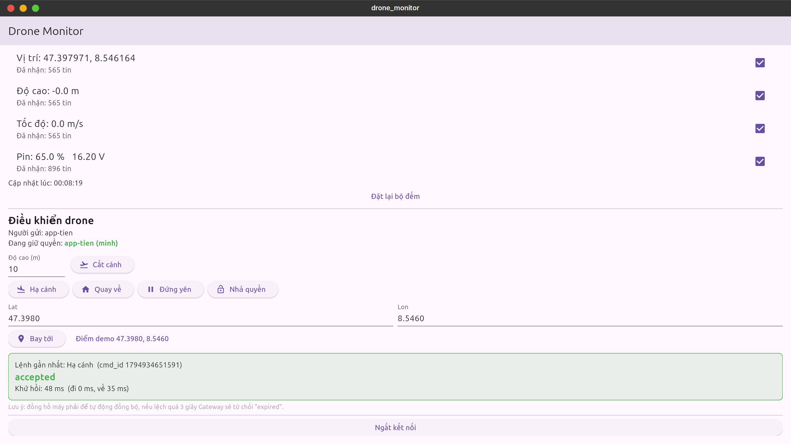
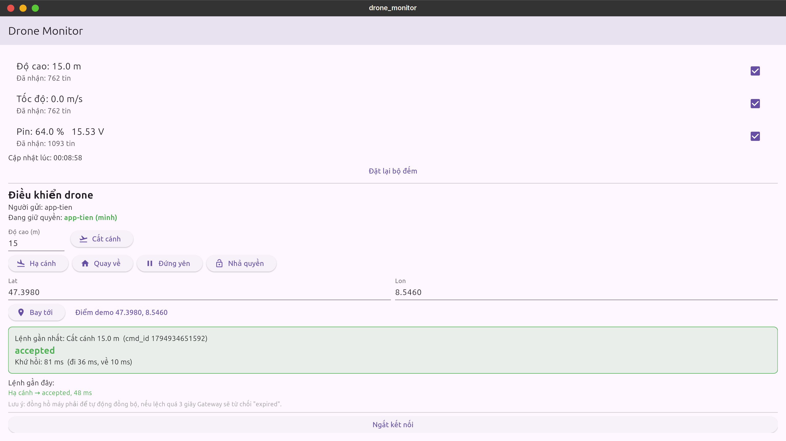
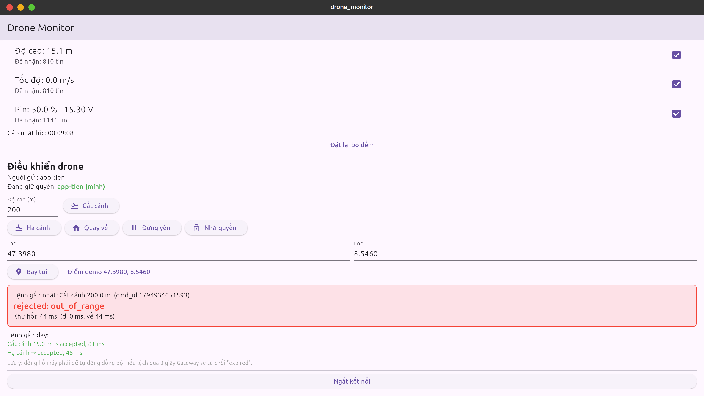
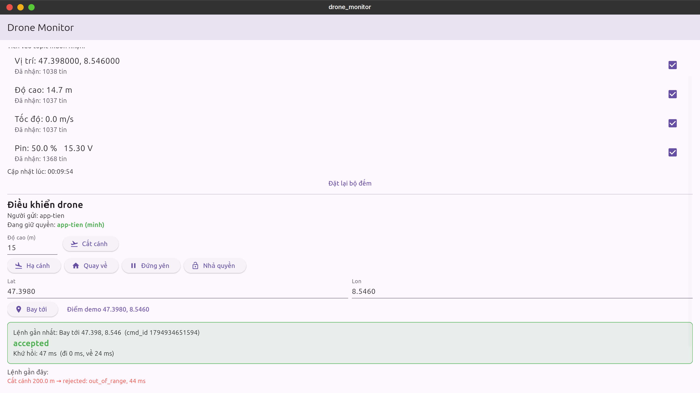
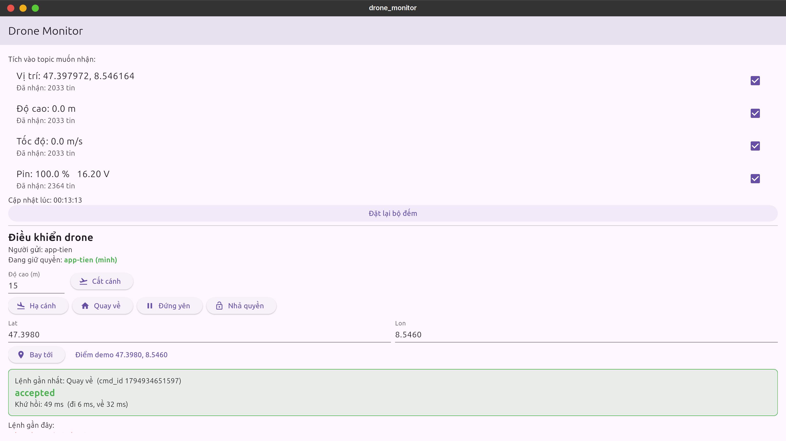
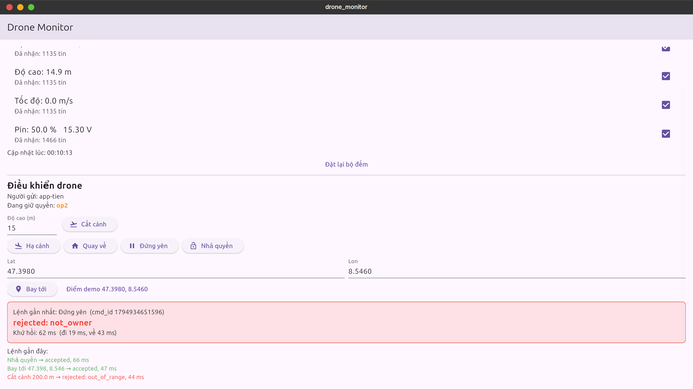
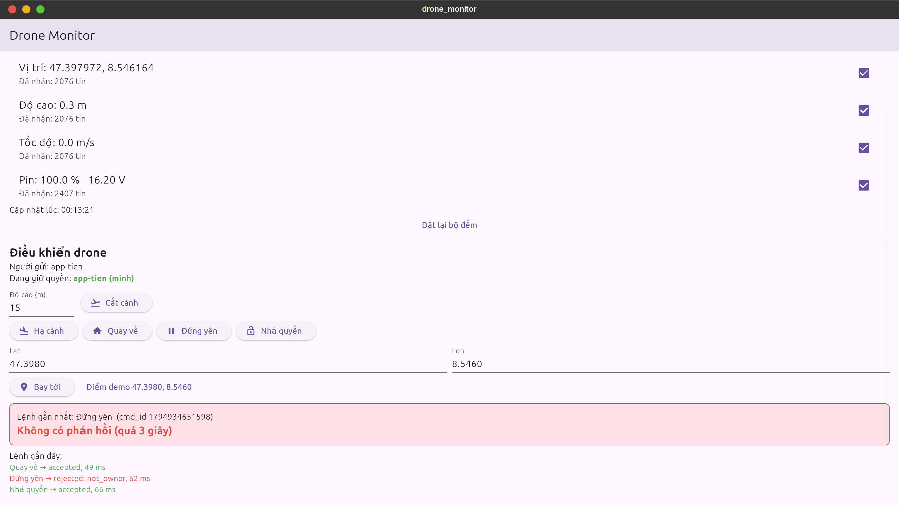
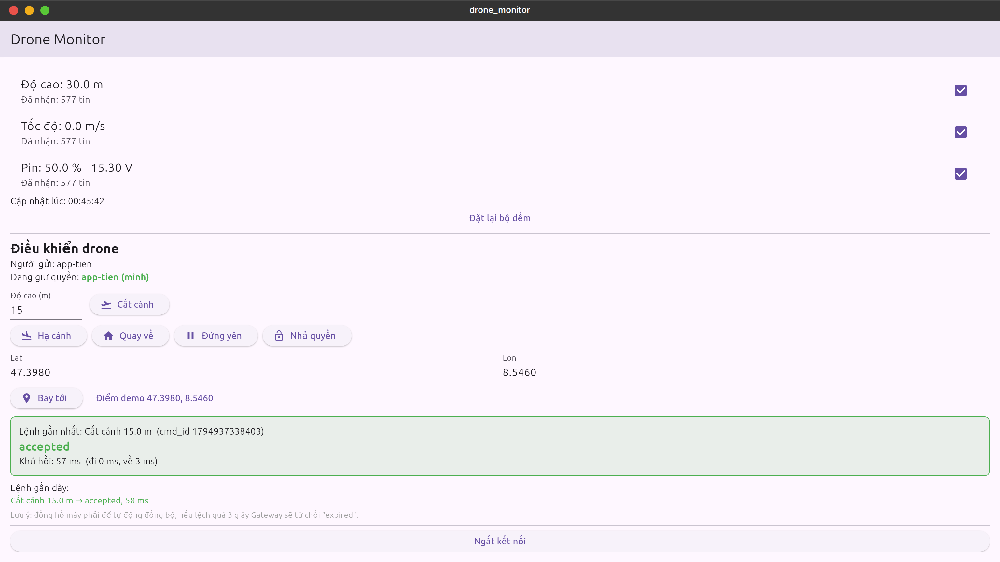

# Báo cáo – Kênh lệnh điều khiển drone (phần của Tiên, bản nháp)

> Số liệu lấy từ `data/H/summary.md` (sinh bằng `./scripts/summarize_H.sh`), đo lại bằng PX4 SITL ngày 17/11/2026.
> Bộ số cũ đo bằng nguồn dữ liệu giả còn trong git ở commit `5dd7169`. Còn thiếu: link video H2.

## 1. Hai chiều dữ liệu trên cùng một Broker

```
                 drone/001/{position,altitude,velocity,battery,status}   (telemetry, chiều lên)
 drone ──▶ Gateway ───────────────────────────────────────▶ Broker ──▶ App / Logger
   ▲          │  ▲                                            │  ▲
   │          │  └──────────── drone/001/cmd  (lệnh, chiều xuống) ──┘  │
   └──────────┘ ─────────────── drone/001/cmd/ack (kết quả) ─────────▶ App / commander
```

Với telemetry, mất một tin cũng không sao vì tin sau thay thế nó. Lệnh thì khác: lệnh **chạy muộn,
chạy hai lần hoặc do hai người cùng gửi** đều nguy hiểm. Chính các tính năng MQTT có ích cho telemetry
lại gây ra những lỗi này, nên Gateway phải kiểm tra từng lệnh trước khi chuyển cho drone.

## 2. Bốn nguy cơ và cách chặn

| # | Nguy cơ do tính năng MQTT | Cách chặn ở Gateway | reason khi từ chối |
|---|---|---|---|
| 1 | **Retained**: Broker gửi lại tin retained mỗi khi Gateway subscribe, tức là sau mỗi lần kết nối lại, nên lệnh cũ chạy lại | Từ chối mọi lệnh có cờ retained | `retained` |
| 2 | **Broker giữ tin QoS 1** khi Gateway vắng mặt (phiên bền), **Paho đệm tin** khi người gửi mất kết nối, nên lệnh tới muộn hàng giây đến hàng chục giây | Lệnh có hạn dùng `ttl_ms` (3 s), từ chối khi `gw_recv_ms − sent_ms > ttl_ms` | `expired` |
| 3 | **QoS 1 "ít nhất một lần"**: tin chưa có PUBACK bị gửi lại (cờ DUP), nên lệnh chạy hai lần | Nhớ cặp `(from, cmd_id)` đã xử lý | `duplicate` |
| 4 | **Ai cũng publish được** lên `drone/001/cmd`, nên hai người cùng điều khiển một drone | Người gửi lệnh hợp lệ đầu tiên giữ quyền; im lặng quá 5 s thì quyền tự nhả | `not_owner` |

## 3. App: nút điều khiển

App gửi lệnh JSON lên `drone/001/cmd` với QoS 1, **không retained**, `from = app-tien`,
`cmd_id` tăng dần bắt đầu từ giờ mở app, `ttl_ms = 3000`. App không tự gửi lại lệnh: bấm lại là một lệnh
mới. Ô kết quả hiện `accepted` (xanh) hoặc `rejected: <reason>` (đỏ) và thời gian khứ hồi, tách thành
chiều đi (App → Gateway) và chiều về (Gateway → App). Sau 3 s không có ack, App hiện "Không có phản hồi".
Dòng "Đang giữ quyền" lấy từ trường `owner` của mọi ack.

Đã kiểm tra bằng tay với Broker, Gateway và PX4 SITL (ngày 18/11/2026, theo đúng các bước của
`app/test/cmd_channel_live_test.dart`). Gateway dùng PX4 không tự kiểm tra trạng thái bay (như cất cánh khi đang
bay) mà để PX4 quyết định, nên bước từ chối được thử bằng lệnh cất cánh 200 m (`rejected: out_of_range`).
Thử thêm cất cánh lần hai khi drone đang bay ở 15 m: PX4 **chấp nhận** và drone bay lên thêm 15 m, tới 30 m.
Như vậy với PX4, một lệnh cất cánh bấm nhầm lần hai không bị chặn; muốn chặn thì Gateway phải tự kiểm tra trạng
thái bay trước khi chuyển lệnh (hướng cải tiến).

| Tình huống | Kết quả |
|---|---|
| Hạ cánh | `accepted`, khứ hồi 48 ms, độ cao về 0 m |
| Cất cánh 15 m, rồi cất cánh 200 m | `accepted` (81 ms), lên 15,0 m; lệnh 200 m `rejected: out_of_range` (44 ms) |
| Cất cánh 15 m lần nữa khi đang bay ở 15 m | `accepted` (57 ms): PX4 nhận lệnh và drone bay lên thêm 15 m, tới 30,0 m |
| Bay tới 47.3980, 8.5460 | `accepted` (47 ms), drone tới 47.398000, 8.546000 |
| App nhả quyền, op2 gửi lệnh | App hiện người giữ quyền là `op2`, lệnh của App bị `not_owner` (62 ms) |
| Quay về | `accepted` (49 ms), drone về điểm xuất phát 47.397972, 8.546164 rồi hạ cánh |
| Tắt Gateway rồi gửi lệnh | "Không có phản hồi (quá 3 giây)" |

Ảnh chụp màn hình App trên Linux desktop:

| | |
|---|---|
|  Hạ cánh: độ cao về 0 m |  Cất cánh 15 m: độ cao 15.0 m |
|  Cất cánh 200 m: `rejected: out_of_range` (hai lệnh trước `accepted`, 48 ms và 81 ms) |  Bay tới: tới 47.398000, 8.546000, `accepted` |
|  Quay về: về điểm xuất phát, độ cao 0.0 m |  op2 giữ quyền: lệnh của App bị `rejected: not_owner` |
|  Tắt Gateway: "Không có phản hồi (quá 3 giây)" |  Cất cánh lần hai khi đang bay: cả hai lệnh `accepted`, drone lên 30,0 m |

## 4. Kết quả thí nghiệm H

Broker, Gateway và `commander` chạy cùng một máy Linux, chung đồng hồ. Gateway điều khiển PX4 SITL v1.17.0 (Gazebo,
x500); trước mỗi lượt `scripts/hover.sh` bảo đảm drone đang hover ở 10 m (kết quả trong `hover.txt` của lượt).

### H1 – Thời gian khứ hồi lệnh (300 lệnh `hold` mỗi lượt, cách nhau 200 ms, 3 lượt mỗi ô)

| Điều kiện | QoS | Số lệnh | timeout | Trung vị (ms) | p95 (ms) | Lớn nhất (ms) | Đi / về trung vị (ms) |
|---|---|---|---|---|---|---|---|
| N0 | 0 | 900 | 0 | 15 | 48 | 64 | 1 / 0 |
| N0 | 1 | 900 | 0 | 42 | 68 | 324 | 1 / 29 |
| N1 (trễ 100 ms) | 0 | 900 | 0 | 378 | 489 | 531 | 202 / 182 |
| N1 (trễ 100 ms) | 1 | 900 | 0 | 457 | 496 | 642 | 196 / 260 |
| N2 (mất 5 %) | 0 | 900 | 0 | 16 | 242 | 617 | 1 / 0 |
| N2 (mất 5 %) | 1 | 900 | 0 | 43 | 383 | 1214 | 1 / 30 |
| N3 (trễ 100 ms + mất 5 %) | 0 | 900 | 0 | 426 | 889 | 1671 | 237 / 189 |
| N3 (trễ 100 ms + mất 5 %) | 1 | 900 | 0 | 484 | 959 | 1785 | 191 / 251 |

"Đi" = commander → Gateway (`gw_recv_ms − sent_ms`), "về" = Gateway → commander (lúc nhận ack − `ack_ms`). Phần
còn lại của khứ hồi là **thời gian Gateway thực hiện lệnh**: MAVSDK gửi lệnh `hold` tới PX4 và chờ PX4 xác nhận,
trung vị 10–16 ms ở mọi lượt. Bộ số cũ (nguồn giả) không có phần này, nên khứ hồi N0 QoS 0 tăng từ 2 lên 15 ms.

So với bộ số cũ: trung vị N0 QoS 0 tăng 2 → 15 ms, N1 tăng 346/449 → 378/457 ms, N2 QoS 1 giảm 80 → 43 ms,
N3 tăng 415/481 → 426/484 ms; p95 N3 tăng 843/915 → 889/959 ms; lệnh chậm nhất giảm 1,85 → 1,79 s.

Netem đặt trên card `eth0` của container Broker, nên chỉ các gói **Broker gửi ra** bị trễ hoặc mất.
Mỗi lệnh đi qua Broker hai lần theo chiều ra: Broker → Gateway (lệnh) và Broker → commander (ack).

Nhận xét chung:

- **Không mất lệnh nào** ở cả 4 điều kiện (0 timeout trên 7200 lệnh), kể cả QoS 0 khi mất 5 % gói. Lý do:
  mất gói xảy ra ở tầng IP, TCP truyền lại, nên ở tầng MQTT chỉ thấy lệnh tới muộn hơn. QoS 0 chỉ mất
  tin khi chính kết nối TCP bị đứt (như H3).
- **Lệnh chậm nhất là 1,79 s (N3, QoS 1), vẫn dưới hạn dùng 3 s**, nên trong mọi điều kiện đã thử,
  kiểm tra 2 không từ chối nhầm một lệnh hợp lệ nào. TTL 3 s còn dư khoảng 1,2 s so với lệnh chậm nhất.

Nhận xét N0:

- Không mất lệnh nào (0 timeout trên 1800 lệnh).
- **QoS 1 khoảng 42 ms (lượt 1 và 2), và phần trễ nằm ở chiều về** (ack từ Gateway tới commander: 27–29 ms),
  chiều đi chỉ 1 ms, Gateway thực hiện lệnh khoảng 12 ms. Nguyên nhân là Nagle của TCP gặp delayed ACK, **đã xác nhận bằng Wireshark**
  (`data/pcap/5_lenh_qos1_N0.pcap`, 20 lệnh hold QoS 1, khứ hồi 41–43 ms). Nhưng gói bị giữ nằm ở **socket
  của Gateway**, không phải ở Broker như giả thuyết ban đầu. Trình tự của mỗi lệnh (lệnh đầu, gói 96–105):

  | Thời điểm | Gói | Diễn biến |
  |---|---|---|
  | 0 ms | commander → Broker → Gateway | PUBLISH lệnh (QoS 1) |
  | 0,1 ms | Gateway → Broker | PUBACK cho lệnh: một gói nhỏ, Broker chưa ACK |
  | ~12 ms | (trong Gateway) | Gateway thực hiện xong lệnh hold qua MAVSDK, gọi publish tin ack (`ack_ms`) |
  | 12–40 ms | (trong Gateway) | Nagle giữ tin ack vì PUBACK trước đó chưa được ACK |
  | 40,2 ms | Broker → Gateway | Broker gửi TCP ACK cho PUBACK, trễ 40 ms do **delayed ACK** |
  | 40,2 ms | Gateway → Broker | ngay sau đó (0,0 ms) tin ack mới lên dây |
  | 40,3 ms | Broker → commander | Broker chuyển tin ack ngay (0,1 ms) |

  Trên 20 lệnh: Broker ACK PUBACK của Gateway sau 40,1–41,3 ms. Tin ack lên dây đúng 0,0 ms sau ACK đó,
  sau khi nằm chờ trong Gateway 19–36 ms (trung vị 29 ms). Broker → commander không bị giữ: commander cũng
  ACK trễ PUBACK của Broker khoảng 40 ms, nhưng lúc đó Broker không có gì cần gửi tiếp. Vì Gateway thực
  hiện lệnh mất 5–21 ms, luôn ít hơn 40 ms, nên khứ hồi luôn bị kéo đúng về khoảng 40 ms. Nagle bật vì
  thư viện Paho mà Gateway dùng không đặt `TCP_NODELAY`; `set_tcp_nodelay true` trên Broker không chữa được
  trường hợp này.
- QoS 0: lượt 1 là 47 ms (chiều đi 34 ms), lượt 2 và 3 chỉ 15 và 10 ms, gần như toàn bộ là thời gian Gateway
  thực hiện lệnh. QoS 1 lượt 3 cũng chậm thêm 25 ms ở chiều đi (67 ms). Phần chậm ở chiều đi này lúc có lúc
  không giữa các lượt; có thể cũng là Nagle (lần này ở chiều commander → Gateway) nhưng chưa bắt gói để xác
  nhận. Vì thế phải báo cả p95 chứ không chỉ trung vị.

Nhận xét N1 (trễ 100 ms):

- Netem chỉ thêm 100 ms cho mỗi chiều Broker gửi ra, nên lẽ ra khứ hồi khoảng 210 ms (200 ms netem cộng
  khoảng 12 ms Gateway thực hiện lệnh). Thực tế là **378 ms (QoS 0) và 457 ms (QoS 1)**.
- Phần trễ thêm là Nagle. Một gói nhỏ phải chờ gói trước được ACK mới được gửi, mà khi mạng trễ thì
  thời gian chờ ACK tăng theo. Mỗi lần bị Nagle giữ lại tốn thêm khoảng 100 ms, thay vì khoảng 40 ms như ở N0.
- Tách theo chiều cho thấy rõ điều này:
  - Chiều về QoS 0 là 182 ms (bộ số cũ: 101 ms). Gateway không gửi PUBACK cho lệnh QoS 0, nhưng vẫn đang phát
    telemetry QoS 1 (20 tin/s), nên tin ack thường phải chờ sau các tin telemetry chưa được ACK, giống cơ chế
    thấy trong `data/pcap/6_N1_nodelay.pcap`. (Suy luận, chưa bắt gói riêng cho lệnh ở N1.)
  - Chiều về QoS 1 là 260 ms (bộ số cũ: 201 ms), gồm trễ netem cộng Nagle: như ở N0, tin ack chờ trong Gateway tới khi Broker
    ACK gói PUBACK, mà ACK này bị netem làm trễ 100 ms. (Suy từ pcap N0 và pcap telemetry ở N1, nơi
    Gateway giữ tin đúng 100 ms; chưa bắt gói riêng cho lệnh ở N1.)
  - Chiều đi khoảng 183–233 ms (trung vị từng lượt): cứ 200 ms lại có một lệnh mới, trong khi lệnh trước chưa
    được ACK.
- Tắt Nagle trên socket của Gateway (`TCP_NODELAY`) sẽ đưa khứ hồi về gần 200 ms. Đó là đề xuất cải tiến,
  không thay đổi khi đang đo.

Nhận xét N2 (mất 5 %):

- Trung vị gần như N0 (16–20 ms với QoS 0, 42–44 ms với QoS 1), vì 95 % gói không bị ảnh hưởng.
- Nhưng **p95 tăng lên 242–383 ms và lớn nhất 617–1214 ms**: đó là các lệnh có gói bị mất, phải đợi TCP
  truyền lại (thời gian chờ truyền lại tối thiểu của Linux khoảng 200 ms, gói mất nhiều lần thì chờ gấp đôi).

Nhận xét N3 (trễ 100 ms + mất 5 %):

- Hai hiệu ứng cộng dồn: trung vị 426–484 ms, như N1 cộng thêm phần truyền lại; p95 889–959 ms;
  lớn nhất 1,79 s.
- Ở N3, QoS 1 chỉ chậm hơn QoS 0 khoảng 58 ms ở trung vị, trong khi QoS 0 vẫn không mất lệnh nào. Vì thế
  với lệnh, QoS 1 **không mang lại thêm độ tin cậy** trong các điều kiện này. Nó chỉ có ích khi kết nối đứt,
  nhưng chính lúc đó lại gây ra lệnh muộn (H2, H3), và kiểm tra 2 phải chặn lại.

### H2 – Lệnh `goto` tới muộn (Gateway tắt khoảng 11 s)

Trước mỗi lượt drone được đưa về điểm xuất phát (47.3977, 8.5456), cách đích `goto` (47.3980, 8.5460) khoảng 45 m.

| Kiểm tra | Lượt | Lệnh bị giữ (ms) | Kết quả | Tốc độ lớn nhất sau khi bật lại |
|---|---|---|---|---|
| bật | 1 / 2 / 3 | 11954 / 11666 / 11733 | `rejected: expired` cả 3 lượt | 0,0 m/s, drone hover tại chỗ |
| tắt (`--cmd-safety off`) | 1 / 2 / 3 | 11934 / 11940 / 11511 | `accepted` cả 3 lượt | 5,2 m/s, drone bay theo lệnh cũ |

Broker giữ lệnh QoS 1 trong phiên bền của Gateway (`clean_session = false`) và giao lại ngay khi Gateway
kết nối lại, lúc lệnh đã 11,5–12 s tuổi. Nếu không có kiểm tra hạn dùng, drone bay theo một lệnh đã gửi từ 12 giây
trước. Kết quả giống bộ số cũ (nguồn giả: `accepted`, 5,0 m/s).

Lần đo đầu tiên bằng PX4 (trước khi sửa) cho kết quả khác: kiểm tra tắt thì cả 3 lượt bị `rejected: out_of_range`
và drone không bay. Lý do là **một lỗi của Gateway**: lệnh tới ngay khi Gateway vừa kết nối, trước tin vị trí đầu
tiên từ PX4. Lệnh `goto` không ghi độ cao nên Gateway lấy độ cao hiện tại, lúc đó vẫn là giá trị khởi tạo 0, và tự
từ chối (dưới 1 m). Drone đứng yên do tình cờ, không phải nhờ được bảo vệ. Lệnh có ghi `alt` còn nguy hiểm hơn: độ
cao đích được tính từ độ cao so với mực nước biển, lúc đó cũng là 0. Đã sửa ở `gateway/src/px4_source.cpp`: trước
khi thực hiện lệnh, Gateway chờ tin vị trí đầu tiên tối đa 2 s, quá 2 s thì trả `not_ready`. Sau khi sửa, drone
giữ đúng độ cao 10 m khi bay theo lệnh `goto`.

### H3 – Broker dừng 5 s giữa chuỗi 100 lệnh QoS 1 (`docker stop` / `docker start`)

| Lượt | Lệnh tới Gateway | `dup_flag = 1` | `duplicate` | `expired` (tuổi lệnh) | accepted |
|---|---|---|---|---|---|
| 1 | 101 | 1 | 0 | 36 (3,0–10,0 s) | 65 |
| 2 | 100 | 0 | 0 | 26 (3,1–8,1 s) | 74 |
| 3 | 101 | 1 | 0 | 35 (3,0–9,8 s) | 66 |

Mỗi lượt có 26–36 lệnh bị `expired` (bộ số cũ: 27 lệnh mỗi lượt). Đó là các lệnh `commander` "gửi" trong lúc
Broker tắt: Paho đệm chúng trong RAM (`send_while_disconnected`) rồi đẩy đi một loạt khi kết nối lại, lúc đó lệnh
đã 3–10 s tuổi. Kiểm tra 2 chặn được hết số lệnh này.

Khác bộ số cũ, lần này **có lệnh bị gửi lại với cờ DUP** ở lượt 1 và 3 (mỗi lượt một lệnh, cùng `cmd_id` tới
Gateway hai lần, nên có 101 lệnh tới Gateway). Nhưng `duplicate` vẫn bằng 0: cả bản gốc lẫn bản gửi lại đều đã
quá 3 s tuổi (9,8–10,0 s), nên kiểm tra 2 chặn trước khi tới kiểm tra 3 (Gateway kiểm tra theo thứ tự 1 → 4).
Như vậy H3 cho thấy QoS 1 có gửi trùng thật, nhưng chưa thử được riêng kiểm tra 3; muốn vậy cần chạy H3 với
`--cmd-safety off` hoặc tắt riêng kiểm tra 2. Số lệnh `accepted` phía commander khớp với Gateway (65 / 74 / 66),
không mất ack nào.

## 5. Kết luận

- Kênh lệnh qua MQTT không mất lệnh nào trong 7200 lệnh ở 4 điều kiện mạng. Khứ hồi 10–67 ms khi mạng
  tốt (gồm khoảng 12 ms PX4 xác nhận lệnh), tới 1,79 s trong trường hợp xấu nhất (N3). Nagle trên socket của Gateway gặp delayed ACK của Broker làm khứ hồi tăng thêm 40 ms
  (N0) tới 100 ms (N1), đã xác nhận bằng Wireshark. Tuy vậy, **không thể tin vào các
  bảo đảm của MQTT để giữ an toàn cho lệnh**. Giữ tin (retained, phiên bền, bộ đệm offline của
  client) và giao lại (QoS 1) đều làm lệnh tới muộn hoặc tới lại.
- Hạn dùng lệnh (kiểm tra 2) là kiểm tra có tác dụng nhất trong các thí nghiệm: nó chặn lệnh trễ 12 s ở
  H2 và 97 lệnh bị đệm ở H3 (gồm 2 bản gửi lại có cờ DUP).
- Kiểm tra 2 dựa vào đồng hồ hai máy khớp nhau, nên điện thoại phải để đồng hồ tự động đồng bộ.
