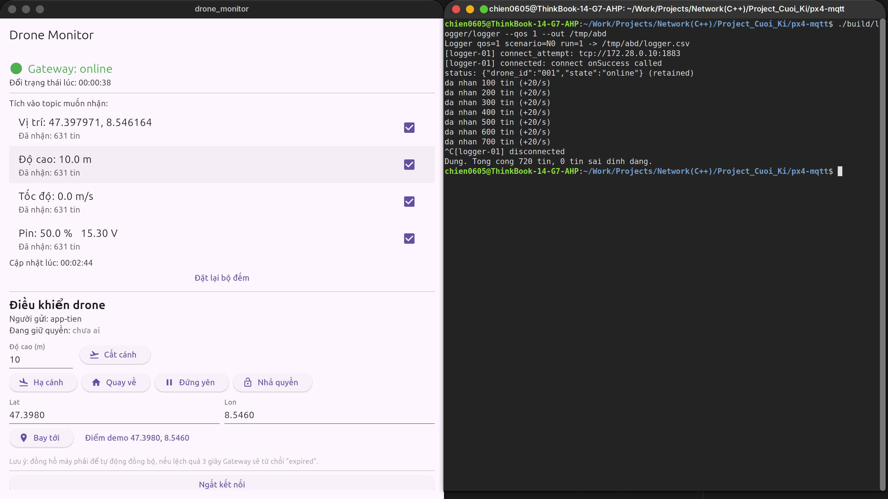
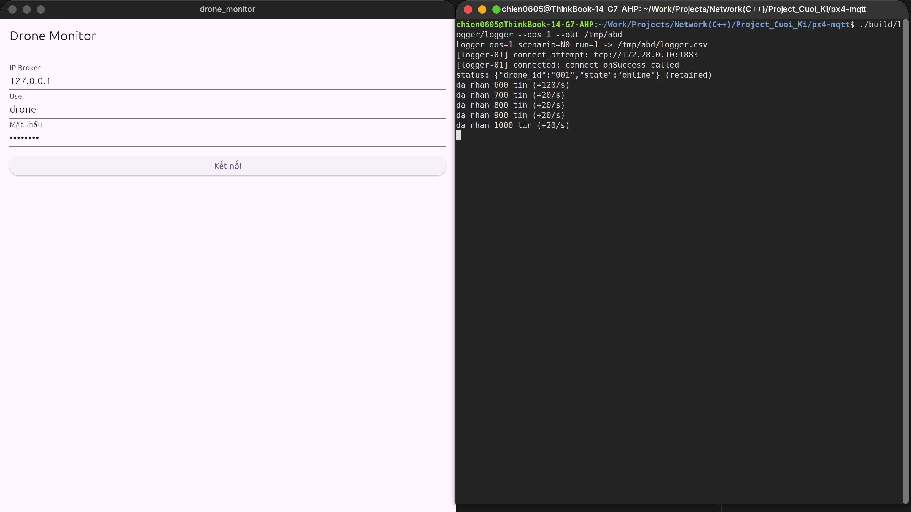
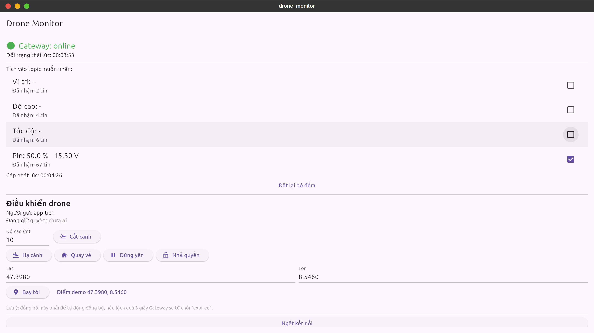
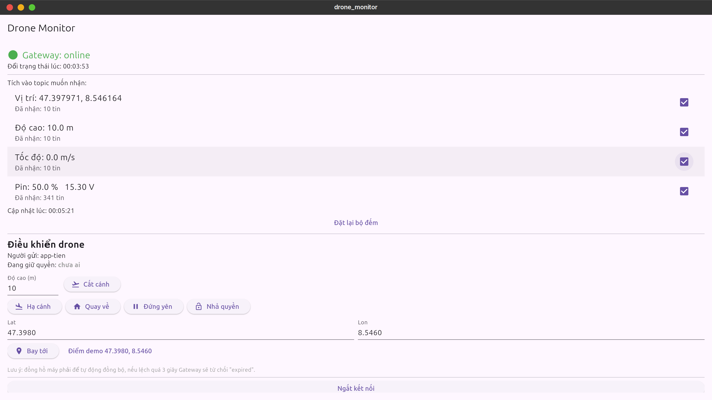
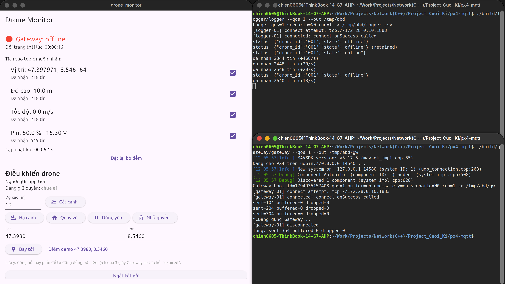
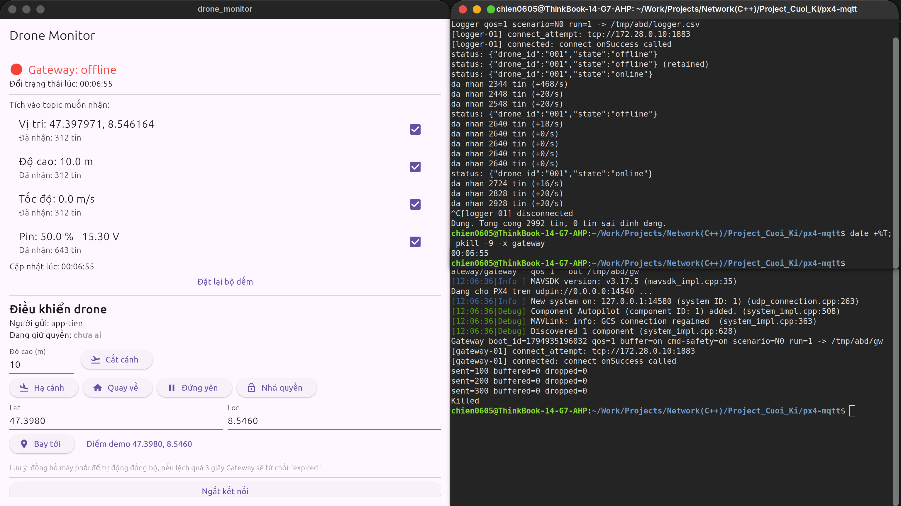

# Thí nghiệm A, B, D (phần của Tiên)

Chạy trên một máy Linux: PX4 SITL v1.17.0 + Gazebo (drone x500 hover ở 10 m), Broker Mosquitto (Docker,
172.28.0.10), Gateway đọc PX4 qua MAVSDK (4 topic × 5 tin/s = 20 tin/s), App Flutter (Linux desktop) và Logger C++.
Ảnh chụp lại với PX4 ngày 18/11/2026, trong `data/A`, `data/B`, `data/D`.

## A – Tắt một client, client còn lại vẫn nhận

| Lượt | Thao tác | Kết quả |
|---|---|---|
| A1 | Ctrl+C Logger (đã nhận 720 tin) | App vẫn cập nhật: "Cập nhật lúc 00:02:44" đúng giờ hệ thống, cả 4 topic vẫn tăng |
| A2 | App bấm "Ngắt kết nối" | Logger vẫn nhận đều `+20/s` (600 → 1000 tin) |

**Nhận xét:** Broker giữ một phiên riêng cho mỗi client và gửi bản sao tin cho từng client đã subscribe.
Một client rời đi không ảnh hưởng client khác, và Gateway (publisher) không cần biết có bao nhiêu client.
Đây là ưu điểm của mô hình publish/subscribe so với kết nối trực tiếp một-một.

## B – Chỉ subscribe topic pin

| Thời điểm | Vị trí | Độ cao | Tốc độ | Pin |
|---|---|---|---|---|
| Sau khi đặt lại bộ đếm và bỏ tích 3 topic (00:04:26) | 2 | 4 | 6 | 67 |
| Sau 55 s, vừa tích lại cả 4 (00:05:21) | 10 | 10 | 10 | 341 |

**Nhận xét:**
- Trong khoảng 55 giây chỉ tích Pin, số tin Pin tăng thêm 274 (≈ 5 tin/s), còn ba topic kia đứng yên.
  Ba topic này chỉ tăng trở lại (4–8 tin trong khoảng 2 giây) sau khi được tích lại.
- App đếm mọi tin Broker gửi tới, không tự lọc. Vì vậy số đếm đứng yên nghĩa là **chính Broker đã ngừng
  gửi** sau gói UNSUBSCRIBE. Việc lọc nằm ở Broker, nên client không tốn băng thông cho dữ liệu không cần.
- Mức pin trong ảnh (50 %) là pin mô phỏng của PX4 SITL.

## D – Tắt Gateway: Ctrl+C và kill -9

| Lượt | Cách tắt | Giờ tắt | App hiện "offline" lúc | Thời gian |
|---|---|---|---|---|
| D1 | Ctrl+C | 00:06:15 (tin cuối cùng) | 00:06:16 | khoảng 1 s |
| D2 | `kill -9` | 00:06:55 (lệnh `date`) | 00:06:55 | dưới 1 s |

**Nhận xét:** cả hai cách đều làm App hiện offline gần như ngay lập tức, nhưng theo hai cơ chế khác nhau.

- **Ctrl+C:** Gateway bắt tín hiệu, tự publish `{"state":"offline"}` (retained) rồi gửi DISCONNECT.
  Khi ngắt đúng cách, Broker **không** phát Last Will, nên Gateway phải tự báo offline.
- **kill -9:** tiến trình bị huỷ ngay, không kịp gửi gì. Nhưng hệ điều hành vẫn đóng socket TCP, nên Broker
  thấy kết nối đứt mà chưa có DISCONNECT. Khi đó Broker phát **Last Will** `{"state":"offline"}` mà Gateway đã
  đăng ký lúc CONNECT.
- Keep-alive (10 s × 1,5 = 15 s) chỉ cần tới khi kết nối "chết lặng": mạng bị cắt nhưng không ai đóng TCP
  (máy Gateway mất điện, rút cáp). Nhóm không đo trường hợp này; theo chuẩn MQTT 3.1.1, App sẽ phải đợi
  khoảng 15 s mới hiện offline.
- Topic `status` là tin retained, nên client kết nối sau vẫn biết ngay trạng thái Gateway, như dòng `(retained)`
  ở đầu log Logger trong ảnh A1.
