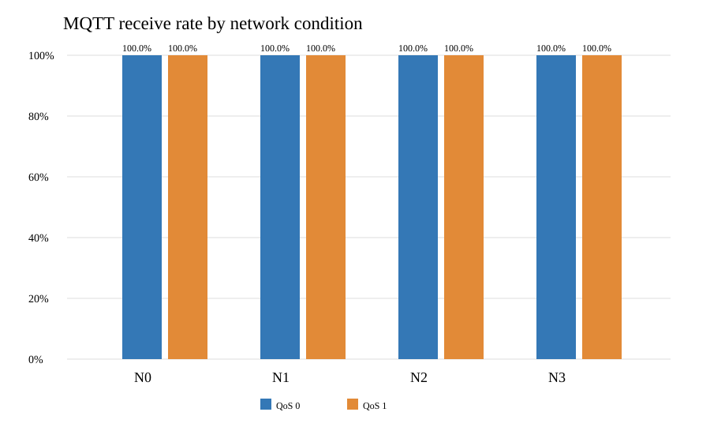
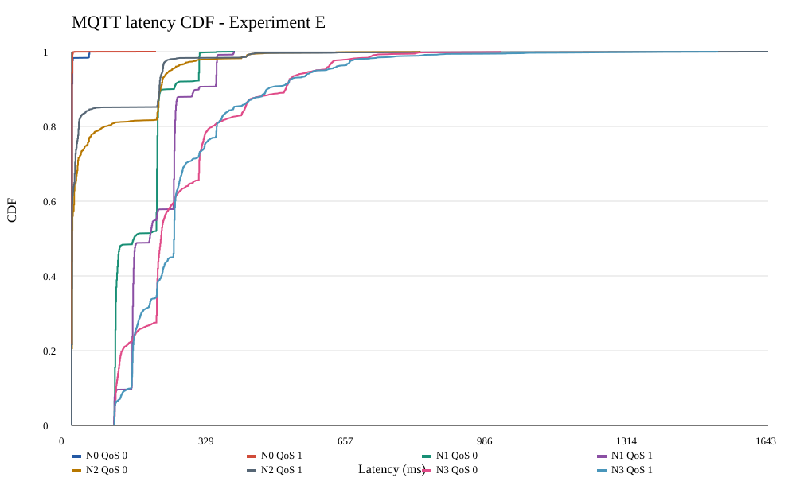

# Thí nghiệm E – QoS 0 và QoS 1 khi mạng xấu

Chạy trên một máy Linux: Broker Mosquitto (Docker, 172.28.0.10), Gateway `--source fake` (4 topic × 5 tin/s
= 20 tin/s), Logger C++ cùng máy với Gateway (chung đồng hồ, nên độ trễ đo được là thật).
2 QoS × 4 điều kiện mạng × 3 lần = **24 lượt**, mỗi lượt Gateway phát 180 s, Logger nhận thêm 15 s.
QoS chạy xen kẽ: lần 1 và 3 chạy QoS 0 trước, lần 2 chạy QoS 1 trước.

| Điều kiện | netem trên eth0 của Broker | ping kiểm tra (50 gói) |
|---|---|---|
| N0 | không | RTT 0,13 ms, mất 0 % |
| N1 | trễ 100 ms | RTT 100,2 ms, mất 0 % |
| N2 | mất 5 % | RTT 0,08 ms, mất 4 % |
| N3 | trễ 100 ms + mất 5 % | RTT 100,1 ms, mất 2 % |

netem chỉ làm xấu **chiều Broker → client** (tin tới Logger, PUBACK về Gateway); chiều Gateway → Broker không
bị ảnh hưởng. "Trễ 100 ms" là thêm 100 ms một chiều.

Chạy lại: `./scripts/run_all_E.sh` (khoảng 90 phút, cần sudo cho netem). Số liệu gốc: `data/E/`.
Bảng và biểu đồ do `b_analyze` sinh ra: `data/plots/` (`per_run.csv`, `summary.csv`, `cdf.svg`, `receive_rate.svg`).
Quy tắc tính: bỏ 10 s đầu theo giờ publish; một tin được định danh bằng `(boot_id, topic, seq)`; trung vị và
p95 lấy phần tử thứ n·50/100 và n·95/100 (giống thí nghiệm H).

## Kết quả (trung bình 3 lần ± độ lệch chuẩn)

| Điều kiện | QoS | Tỷ lệ nhận | Tin trùng | Trễ trung vị (ms) | Trễ p95 (ms) |
|---|---|---|---|---|---|
| N0 | 0 | 100 % | 0 | 1 ± 0 | 2 ± 0 |
| N0 | 1 | 100 % | 0 | 0,7 ± 0,6 | 1,7 ± 0,6 |
| N1 | 0 | 100 % | 0 | 147 ± 3 | 301 ± 0 |
| N1 | 1 | 100 % | 0 | 175 ± 20 | 342 ± 0 |
| N2 | 0 | 100 % | 0 | 1,3 ± 0,6 | 234 ± 12 |
| N2 | 1 | 100 % | 0 | 1 ± 0 | 213 ± 4 |
| N3 | 0 | 100 % | 0 | 211 ± 4 | 573 ± 24 |
| N3 | 1 | 100 % | 0 | 241 ± 1 | 589 ± 57 |

## Nhận xét

1. **Không mất tin nào, kể cả QoS 0 ở điều kiện mất 5 %.** Mất gói ở đây là mất **gói TCP**, không phải mất bản tin
   MQTT. Kết nối TCP vẫn sống nên TCP tự truyền lại gói bị mất; bản tin chỉ tới muộn hơn. Không lượt nào bị mất
   kết nối (`events.csv` chỉ có một lần `connected` mỗi lượt), nên QoS 0 cũng nhận đủ 100 %.

2. **Không có tin trùng ở cả QoS 1.** Đúng như kế hoạch dự đoán: trên một kết nối đang sống, MQTT 3.1.1 không gửi
   lại PUBLISH; client chỉ gửi lại tin QoS 1 (cờ DUP) sau khi kết nối lại. Tin trùng chỉ xuất hiện khi có mất kết
   nối, như ở thí nghiệm C (1–2 tin mỗi lượt).

3. **Mạng xấu làm tăng độ trễ, không làm mất tin.**
   - N2 (mất 5 %): trung vị vẫn khoảng 1 ms, nhưng p95 lên khoảng 210–235 ms. Phần lớn tin tới ngay, khoảng 5 %
     tin dính gói bị mất phải chờ TCP truyền lại (thời gian chờ tối thiểu của Linux khoảng 200 ms).
   - N1 (trễ 100 ms): mọi tin chậm ít nhất 100 ms, trung vị khoảng 150 ms, p95 khoảng 300 ms.
   - N3 cộng dồn cả hai: p95 khoảng 570–590 ms.

4. **QoS 1 không giúp gì thêm khi kết nối còn sống.** Ở N1 và N3, trung vị QoS 1 chênh QoS 0 khoảng 30 ms, nhưng
   chênh lệch này đến từ thuật toán Nagle (ý 5), không phải từ QoS: khi tắt Nagle, QoS 0 và QoS 1 trễ như nhau
   (102 và 103 ms). Lợi ích của QoS 1 chỉ thấy rõ khi **mất hẳn kết nối** (thí nghiệm C và F), nơi QoS 1 + phiên
   bền giúp nhận bù 100 % thay vì mất hết.

5. **Trễ trung vị ở N1 (khoảng 150 ms) lớn hơn 100 ms netem thêm vào là do thuật toán Nagle của TCP trên Broker
   (đã kiểm chứng).** Nagle gom các gói nhỏ lại: khi gói trước chưa được ACK, gói tiếp theo phải chờ. Đường bị trễ
   100 ms làm ACK về chậm, nên nhiều tin phải chờ thêm. Mosquitto mặc định không tắt Nagle (`set_tcp_nodelay false`).
   Kiểm chứng bằng cách chạy lại N1, mỗi lần 70 s (bỏ 10 s đầu, khoảng 1200 tin):

   | `set_tcp_nodelay` | QoS | Trễ trung vị | Trễ p95 |
   |---|---|---|---|
   | false (mặc định, Nagle bật) | 0 | 202 ms | 301 ms |
   | false (mặc định, Nagle bật) | 1 | 145 ms | 343 ms |
   | true (Nagle tắt) | 0 | **102 ms** | 202 ms |
   | true (Nagle tắt) | 1 | **103 ms** | 202 ms |

   Tắt Nagle thì trung vị về đúng khoảng 100 ms netem thêm vào, và hết chênh lệch giữa QoS 0 và QoS 1. Khi Nagle
   bật, trung vị dao động mạnh (145–202 ms) tuỳ thời điểm tin rơi vào lúc chờ ACK. p95 vẫn khoảng 200 ms dù tắt
   Nagle; phần chậm thêm ở các tin cuối này chưa tìm hiểu.
   Nhóm giữ cấu hình mặc định cho toàn bộ thí nghiệm. Với telemetry cần trễ thấp thì nên bật
   `set_tcp_nodelay true` trên Broker.

## Kết luận

Với telemetry gửi đều 20 tin/s qua một kết nối TCP còn sống, **TCP đã đảm bảo không mất tin**; mạng xấu chỉ làm
tin tới muộn hơn (p95 tới khoảng 0,6 s ở N3), và thuật toán Nagle trên Broker còn cộng thêm khoảng 50–100 ms khi
đường truyền bị trễ. QoS 1 không cải thiện tỷ lệ nhận trong trường hợp này. QoS 1 chỉ đáng dùng khi có nguy cơ **mất kết nối**, và phải kết hợp với phiên bền (`clean_session = false`)
hoặc bộ đệm phía client mới có tác dụng (xem thí nghiệm C, F).
